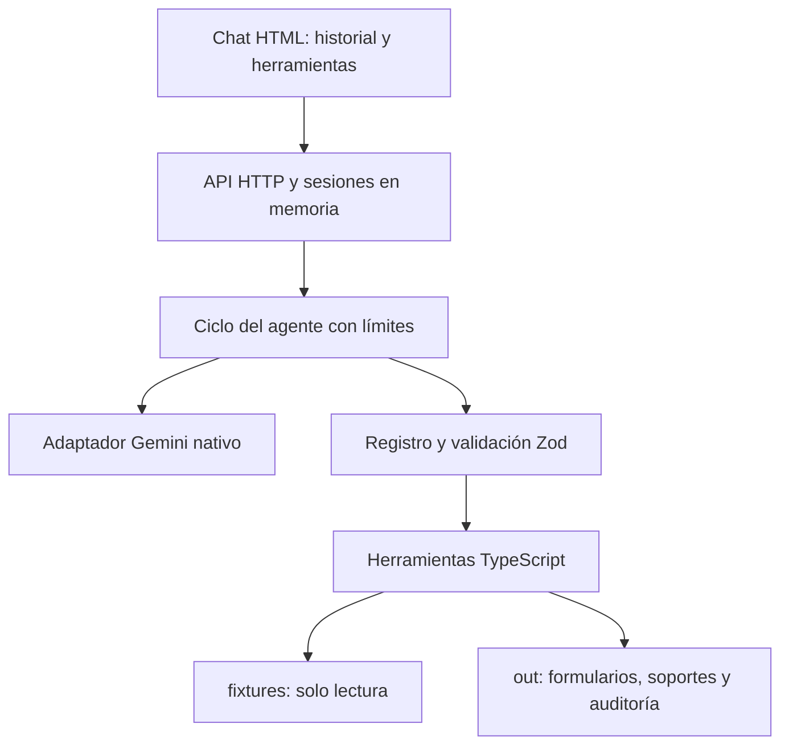

# Solución — Agente de registro como proveedor

## 1. Problema en una frase

La analista administrativa necesita preparar registros de proveedor sin retranscribir datos existentes ni omitir soportes o revisiones humanas.

## 2. Arquitectura

- `agent/prompt.md`: comportamiento y límites del asistente.
- `src/knowledge/registro-proveedor.md`: conocimiento del proceso y reglas descritas.
- `src/tools/proveedor.ts`: ejecución determinista, lectura, mapeo, generación y paquete.
- `src/tools/formatos.ts`: escritura de PDF y valores de portal.
- `src/tools/registro.ts`: nombres de herramientas, JSON Schema y validación Zod previa a ejecutar.
- `src/llm/adapter.ts`: contrato propio `enviar(mensajes, herramientas, maxTokens)`.
- `src/llm/gemini.ts`: implementación contra la API nativa `generateContent`.
- `src/agente.ts`: ciclo del agente y autorización de simulación.
- `src/server.ts`: HTTP, límites de entrada y descargas.

El navegador nunca conoce la clave. Los valores se obtienen de herramientas; el modelo no escribe directamente formularios. Las herramientas recalculan el mapeo desde los fixtures y rechazan un mapeo alterado.

## 3. Ciclo del agente y confirmación

El backend carga prompt y conocimiento una vez por sesión, incorpora el mensaje y consulta al adaptador. El modelo solicita herramientas mediante function calling. Se validan los argumentos, se ejecuta la función y se devuelve su resultado al historial del modelo.

Se expone el siguiente paso del flujo: leer → mapear → generar → armar paquete. El backend rechaza saltos de etapa y cambios de caso durante ese flujo. Un paquete requiere un formulario generado en el turno actual; no se acepta el archivo de una demo anterior como prueba de generación.

Al completar el paquete se construye un resumen determinista con campos/fuentes, faltantes, confirmaciones y checklist. Se evita una consulta final al modelo que podría fallar después de producir los archivos. El chat sigue siendo un agente real: las llamadas previas se originan en el modelo; la demo directa se ofrece separadamente.

Se conservan las partes nativas y firmas opacas de Gemini en la memoria interna para mantener el historial de herramientas válido. No se exponen en `/api/sessions` ni se registran en logs.

El máximo predeterminado es 10 iteraciones (configurable hasta 25), con presupuesto conservador por sesión y por proceso. Cada petición reserva entrada/salida para hasta dos intentos, incluso si falla. Solo 503 se reintenta una vez, con una pausa de 1.2 segundos y timeout de 30 segundos por intento. No se reintenta automáticamente 429. Los presupuestos son límites operativos conservadores, no una medición exacta de la factura.

El agente guarda un caso pendiente solo tras un paquete exitoso y pregunta por la simulación. El siguiente mensaje humano debe ser una confirmación explícita reconocida. La autorización se consume y el modelo no puede concedérsela con `confirmado: true`. La simulación únicamente escribe `ENVIO-SIMULADO.md`; no demuestra firma, envío real ni subsana soportes vencidos.

Cada llamada aparece en el chat. La auditoría persistente almacena fecha, herramienta, resultado y resumen sin prompts, secretos ni argumentos completos. Hay registros globales y por caso. Los errores controlados no eliminan la sesión ni inventan archivos inexistentes.

## 4. Elección del modelo y costo estimado

Proveedor: Gemini Developer API. Modelo predeterminado configurable: `gemini-3.1-flash-lite`, listado en la cuenta durante la preparación y con una respuesta de texto comprobada en la prueba directa. La disponibilidad y cuota para el flujo completo deben validarse en la cuenta y en el alojamiento final.

Se eligió por acceso a un nivel gratuito sujeto a cuotas y soporte de llamadas a herramientas. El adaptador usa REST nativo, sin SDK adicional, para mantener explícito el historial y reducir conversiones de compatibilidad.

Estimación orientativa por caso: hasta cuatro consultas habituales al modelo, con aproximadamente 6000–18000 tokens de entrada acumulados y 2000–6000 de salida según plantilla, argumentos y reintentos. No es una medición de un caso real completo. En el nivel gratuito elegible, el costo monetario del modelo es USD 0 dentro de su cuota; agotarla puede bloquear la solicitud. Fuera de ese nivel, el costo estimado se calcula como `(tokens_entrada × tarifa_entrada + tokens_salida × tarifa_salida) / 1000000`, con las tarifas vigentes del modelo. El alojamiento se cobra o limita por separado.

Precios y límites oficiales: https://ai.google.dev/gemini-api/docs/pricing

No se activa facturación desde el código ni se reintenta ilimitadamente. Las claves se configuran por variables de entorno. Los contadores en memoria se reinician con el proceso: producción requiere control durable de consumo y límites del proveedor.

## 5. Diseño del portal web

La versión entregada responde `formato no soportado` y genera `valores-portal.md`. No abre portales ni recibe contraseñas.

En producción usaría un navegador controlado en una sesión asistida. El humano inicia sesión e ingresa las credenciales y MFA directamente en el portal. Las credenciales nunca forman parte del repositorio, prompt ni logs; si la organización usa un gestor de secretos, se integra con una sesión del navegador sin revelar valores al modelo.

El agente identificaría controles, propondría equivalencias y completaría únicamente campos aprobados. Se detendría ante CAPTCHA, MFA, cambios de layout o controles ambiguos. El humano revisaría los datos, cargaría o aprobaría soportes y realizaría el clic final en Enviar. No se evaden mecanismos de acceso. Se necesitarían pruebas por portal y capturas de evidencia con datos sensibles ocultos.

## 6. Decisiones y trade-offs

| Decisión | Alternativa descartada | Motivo / costo |
| --- | --- | --- |
| Mapeo exacto con glosario | Inferencia libre de valores por el modelo | Evita inventar información bancaria o tributaria; etiquetas desconocidas quedan faltantes |
| ExcelJS y pdf-lib | Automatizar Excel instalado o rellenar archivos originales | No se entregaron binarios originales; los JSON son la especificación oficial |
| HTML y HTTP nativo de Node | Framework frontend y servidor adicionales | Menos configuración y dependencias; interfaz suficiente para historial, herramientas y confirmación |
| Archivos y sesiones en memoria | Base de datos | Suficiente para evaluación; reinicios pierden sesiones y el disco puede ser efímero |
| API nativa Gemini | Capa compatible con Chat Completions | Hace explícitas las function calls y firmas; requiere conversión interna de mensajes |
| Resumen final determinista | Otra consulta para redactar el resultado | Asegura que el estado mostrado provenga del paquete y evita fallar al final por disponibilidad del modelo |
| Portal solo documentado | RPA real con credenciales | Fuera del alcance y exige intervención humana y validación específica |

Dependencias: Zod valida contratos; ExcelJS genera XLSX; pdf-lib genera PDF; dotenv carga el entorno exclusivamente en Node. tsx ejecuta TypeScript; TypeScript y tipos de Node validan el código. `node:test` verifica reglas y el protocolo sin depender de una clave real.

## 7. Supuestos

- Los fixtures son ficticios, se preservan sin modificar y son la fuente oficial.
- La fecha de evaluación de vigencias es la fecha de ejecución en `America/Bogota`.
- Se acepta el JSON de plantilla como especificación del formulario, pues no hay Excel/PDF originales.
- Un identificador extranjero se escribe con el NIT colombiano y una nota pendiente de revisión; nunca se presenta como RUC/RTN local validado.
- Los faltantes no bloquean `listo_para_firma` por RN3; los soportes ausentes o vencidos sí. Un portal no se declara listo para firma porque su formulario no se implementa.
- Se pueden copiar soportes vencidos para evidencia, claramente marcados y bloqueando el estado.
- La simulación puede registrar la preparación con observaciones, pero no equivale a enviar ni aprobar ese paquete.
- Uso individual de evaluación, con datos ficticios. No hay aislamiento de archivos por sesión ni autenticación de descargas.

## 8. Cobertura

| Historia | Estado de implementación | Evidencia / pendiente para producción |
| --- | --- | --- |
| HU-1 Leer solicitud | Hecho | Lectura y validación de correo, plantilla y soportes; falta integración real con correo |
| HU-2 Mapear al maestro | Hecho | Fuentes exactas, faltantes y reglas de país; hace falta catálogo mantenido por responsables del dato |
| HU-3 Formatos | Hecho en alcance P0/P1/P2 | XLSX y PDF; portal solo valores como exige el reto; binarios reales heterogéneos requerirían adaptadores |
| HU-4 Paquete y cierre humano | Hecho | Copias, checklist, borrador, pregunta y simulación; firma/envío real fuera de alcance |
| HU-5 Errores | Hecho para escenarios probados | Casos inexistentes/corruptos y fallos HTTP controlados; faltan pruebas extensivas de red y alojamiento |

Separar implementación de validación real: las pruebas automatizadas usan transporte/modelo simulado y herramientas/archivos reales. Pasarlas no acredita que Google esté disponible ni que el enlace público esté desplegado. Antes de entregar debe probarse un flujo completo con la clave privada del candidato y añadirse la URL real al README.

## 9. Uso de IA

Se utilizó ChatGPT/Codex para interpretar el PRD, construir herramientas TypeScript, diseñar prompt y conocimiento, preparar la interfaz y el adaptador, analizar errores, generar pruebas y redactar documentación.

Se descartaron valores inferidos sin fuente y el intento de resolver fallos persistentes únicamente cambiando modelos o repitiendo peticiones. Se corrigió una función de reintento que se llamaba a sí misma y no era usada por el adaptador. Se reemplazó la capa de compatibilidad por la API nativa y se añadió control de orden para impedir reutilizar archivos de una demo anterior.

La candidata debe revisar y poder explicar los archivos entregados. No se compartió la clave de Gemini con el asistente ni se incluyó una clave real en este paquete de revisión.

## 10. Riesgos de producción y mitigaciones

- **Disponibilidad/cuota del modelo:** fallos 503/429; reintento acotado, timeout, límites, monitoreo y un segundo adaptador probado si se requiere continuidad. No usar una demo determinista como sustituto silencioso de IA.
- **Alucinaciones:** valores y archivos exclusivamente desde herramientas; mapeos verificados y resumen final derivado. El texto libre previo del modelo sigue necesitando revisión y pruebas de ataques.
- **Prompt injection:** correo y archivos se tratan como datos, herramientas acotadas sin shell ni acciones externas; ampliar pruebas con entradas maliciosas.
- **Secretos:** variables de entorno backend, `.gitignore`, `.dockerignore`, errores controlados y escaneo local. Añadir gestor de secretos, rotación, escaneo de historial y controles en CI.
- **Datos personales:** la demo es pública solo con fixtures ficticios. En producción exigir autenticación, autorización por sesión/archivo, retención y cifrado.
- **Concurrencia y persistencia:** `out/<caso>` es compartido; añadir espacios por trabajo, bloqueo de escritura y almacenamiento durable. Sesiones y presupuesto deben persistirse por usuario/organización.
- **Soportes desactualizados:** dueño del dato, versionado, vencimientos y validación de país/certificación por cliente.
- **Portal:** CAPTCHA/MFA, cambios de layout y envíos irreversibles requieren asistencia humana y límites por portal.
- **Despliegue:** disco efímero y reinicios pueden perder resultados y presupuestos; usar almacenamiento durable y verificar el enlace durante la defensa.
